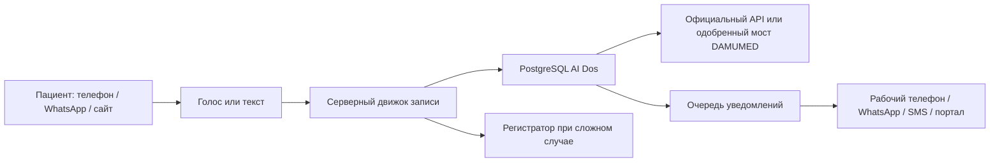

# AI Dos — production playbook клиники

Версия: 2026-08-14  
Production: https://ai-dos-sage.vercel.app

Этот документ описывает реальную эксплуатацию AI Dos: что работает без AI,
как тестируется голос, как подключается телефон, как устанавливается
одобренный DAMUMED Bridge, как подключается официальный WhatsApp и какие
компоненты ещё нельзя считать готовыми без внешнего провайдера.

## 1. Короткий ответ: как устроен AI Dos

AI Dos состоит из пяти независимых контуров:

1. **Портал и база данных.** Пациенты, врачи, услуги, расписание, записи,
   согласия, задачи, уведомления и история хранятся в PostgreSQL. Это работает
   без генеративного AI.
2. **Детерминированный движок записи.** Проверяет личность, подбирает врача,
   предлагает реальные слоты, требует подтверждение и защищает от двойной
   записи. Он работает по правилам и ограничениям базы, а не «по догадке AI».
3. **Разговорный слой.** Gemini Live используется в браузерной голосовой
   лаборатории; OpenAI Realtime рассчитан на входящие SIP-звонки. Модель только
   разговаривает и вызывает разрешённые инструменты. Запись создаёт серверный
   движок.
4. **МИС.** AI Dos сначала фиксирует запись в своей базе. Затем фоновый адаптер
   переносит её в DAMUMED и обязательно перечитывает результат.
5. **Каналы доставки.** WhatsApp, SMS, email и Telegram получают сообщения из
   единой очереди. Без credentials внешнего провайдера сообщения остаются в
   честном статусе `blocked`.



## 2. Что можно делать без AI

Без генеративного AI уже работают:

- вход сотрудников и разграничение ролей;
- ведение врачей, услуг, цен и расписания;
- создание, перенос и отмена записи;
- проверка занятости и запрет двойной записи;
- идентификация пациента по телефону и второму фактору;
- лист ожидания, callback, задачи и срочные запросы;
- база знаний как управляемый справочник;
- аудит действий, отчёты, лимиты и billing-учёт;
- очередь уведомлений и повторы доставки;
- DAMUMED Bridge: это обычная детерминированная автоматизация DOM, не AI.

Без AI невозможно сохранить именно свободный естественный голосовой разговор.
Вместо него можно сделать классическое IVR: записанные фразы, кнопки телефона
«1 — запись, 2 — отмена», распознавание DTMF и перевод оператору. Это надёжнее и
дешевле, но пациент не сможет разговаривать своими словами.

Рекомендуемая схема:

- критические действия — только детерминированный серверный код;
- AI — только понимание фразы и естественный голос;
- врач, время и факт записи — только из базы или подтверждённого DAMUMED;
- при сомнении — задача человеку, а не догадка модели.

## 3. Текущая честная готовность production

| Контур | Сейчас | Что нужно для реальной клиники |
|---|---|---|
| Портал и PostgreSQL | Работают | Заполнить реальные данные клиники |
| Web-чат пациента | Работает | Проверить тексты и правила клиники |
| Gemini Live в браузере | Работает | Микрофон и согласие на запись |
| Реальный телефонный номер | Код приёма SIP есть, линия не подключена | SIP-номер, OpenAI project/webhook, контрольные звонки |
| Финальный статус телефонного звонка | Не завершён | Sideband-worker или signed webhook SIP-провайдера |
| Уведомление сотруднику о звонке | Не завершено end-to-end | Рабочий номер, канал SMS/WhatsApp, статусный источник |
| Исходящий WhatsApp | Универсальная очередь готова | Официальный Meta/BSP gateway и шаблоны |
| Входящий WhatsApp | Не реализован | Meta webhook, подпись, входящие сообщения и delivery statuses |
| DAMUMED official API | Ожидает доступ | Договор, документация и credentials |
| DAMUMED Browser Bridge | Код готов, live DOM не подтверждён | Письменное разрешение, Chrome клиники и тестовый пациент |

## 4. Подготовка клиники с нуля

### 4.1. Что собрать заранее

Клиника назначает одного ответственного и подготавливает:

- юридическое название, филиалы, адреса и часовой пояс;
- врачей, специальности, кабинеты, услуги, цены и длительность;
- недельные графики, перерывы и отпуска;
- утверждённые ответы базы знаний на RU/KK/EN;
- рабочий телефон сотрудника для тревог и callback;
- существующий номер клиники или решение купить новый SIP-номер;
- Meta Business Portfolio, если нужен WhatsApp;
- письменное основание обработки данных и согласия на запись разговора;
- разрешение владельца/оператора DAMUMED на выбранный способ интеграции;
- обезличенного тестового пациента.

### 4.2. Создание клиники в AI Dos

1. Открыть https://ai-dos-sage.vercel.app/register.
2. Создать рабочее пространство клиники.
3. Войти как администратор.
4. В разделе **Клиника** заполнить филиалы, отделения, врачей и услуги.
5. В разделе **Расписание** внести рабочие часы врачей.
6. В разделе **База знаний** добавить только проверенные материалы.
7. Пригласить регистраторов и врачей с минимально необходимыми ролями.
8. В **Настройках** скопировать ID рабочего пространства — он понадобится
   для привязки DAMUMED Bridge.

### 4.3. Контроль качества данных

До голоса и интеграций вручную проверить:

- запрос конкретного специалиста возвращает правильного врача;
- график врача совпадает с клиникой;
- нет тестовых услуг, которых клиника не оказывает;
- цена и длительность услуги правильные;
- создание двух записей на один слот невозможно;
- перенос и отмена требуют явного подтверждения;
- срочный или медицинский вопрос уходит человеку.

## 5. Полный workflow записи пациента

1. Пациент звонит или пишет.
2. Система определяет язык или использует выбранный язык.
3. Пациент формулирует запрос.
4. Разговорный слой определяет намерение: FAQ, запись, перенос, отмена,
   callback или человек.
5. Для записи система находит специальность и врача только в каталоге клиники.
6. Система запрашивает свободные слоты из живой БД/свежего снимка DAMUMED.
7. Пациент выбирает время.
8. Система проверяет личность: телефон плюс фамилия или дата рождения.
9. Перед изменением система повторяет врача, дату и время и получает «да».
10. PostgreSQL атомарно создаёт запись; конфликт слота отклоняется базой.
11. Только после успеха пациент слышит «вы записаны».
12. Запись ставится в очередь внешней МИС.
13. Адаптер создаёт запись в DAMUMED и перечитывает карточку.
14. Успех получает статус `synced`; неопределённый результат становится
    задачей сотруднику и не отправляется повторно, чтобы не создать дубль.
15. Очередь уведомлений отправляет подтверждение пациенту и, после подключения
    соответствующего сценария, статус сотруднику.

## 6. DAMUMED: официальный путь

Это основной production-вариант и единственный вариант, который не требует
отдельного исключения из исходной политики продукта.

1. Клиника запрашивает у DAMUMED/интеграционного партнёра официальный API или
   интеграционный шлюз.
2. Получает договор, sandbox, документацию, список разрешённых операций,
   credentials и правила хранения данных.
3. Настраивается tenant-scoped адаптер: врачи, услуги, графики, создание,
   перенос, отмена и повторное чтение записи.
4. Выполняются contract-тесты и тесты идемпотентности.
5. После приёмки переключается режим интеграции.

Если официального доступа нет, production должен оставаться в `sandbox`.

## 7. DAMUMED Browser Bridge на реальном компьютере

Browser Bridge нельзя считать официальной интеграцией. Его разрешено включать
только при письменном одобрении клиники и владельца/оператора DAMUMED. Без такого
разрешения остановиться на `sandbox` и не устанавливать расширение.

### 7.1. Что делает мост

- работает только в уже авторизованной вкладке `reg-ala.dmed.kz`;
- не знает и не сохраняет пароль DAMUMED;
- читает врачей и свободные времена без ФИО занятых пациентов;
- берёт одну подтверждённую запись AI Dos из защищённой очереди;
- выбирает точного пациента, врача, дату, время и услугу;
- после сохранения перечитывает карточку пациента в нужном слоте;
- не создаёт пациента, не отправляет ИИН и не угадывает неоднозначный элемент;
- при изменении DOM останавливается с ошибкой.

### 7.2. Установка в Chrome

Папка расширения:
`workers/damumed-browser-extension`

1. Скопировать всю папку на компьютер клиники в постоянное место, например
   `C:\\AI-Dos\\damumed-browser-extension`. Не запускать её из временной папки.
2. Открыть Chrome и ввести `chrome://extensions`.
3. Включить **Режим разработчика**.
4. Нажать **Загрузить распакованное расширение**.
5. Выбрать папку `damumed-browser-extension`.
6. Закрепить **AI Dos · DAMUMED Bridge** на панели Chrome.
7. Открыть `https://reg-ala.dmed.kz`, войти обычной учётной записью регистратора
   и открыть раздел записи на приём.
8. Нажать иконку AI Dos Bridge.

### 7.3. Настройка production

На сервере Vercel должны быть три переменные:

```dotenv
MIS_ADAPTER=remote
MIS_WORKER_SECRET=<случайный секрет не короче 32 байт>
MIS_WORKER_TENANT_ID=<ID клиники из портала>
```

В расширение вводятся:

- AI Dos URL: `https://ai-dos-sage.vercel.app`;
- тот же `MIS_WORKER_SECRET`;
- тот же `MIS_WORKER_TENANT_ID`.

Секрет нельзя пересылать в обычном чате или сохранять в документах клиники.
После смены production-переменных нужен новый Vercel deployment.

### 7.4. Что означает `MIS_ADAPTER=remote`

Это не «включить DAMUMED одной кнопкой». Значение говорит серверу:

- не считать запись завершённой только внутри sandbox;
- поставить подтверждённую запись в защищённую очередь МИС;
- разрешить внешнему воркеру конкретной клиники забрать её на 10 минут;
- принять результат только от воркера с правильным secret;
- считать перенос успешным только при `verified=true`;
- после неоднозначной отправки не повторять автоматически, а создать задачу.

Без `MIS_WORKER_SECRET` и `MIS_WORKER_TENANT_ID` режим намеренно не готов.

### 7.5. Приёмочный тест моста

Порядок нельзя сокращать:

1. Оставить **Безопасную проверку** включённой.
2. Нажать **Проверить страницу**.
3. Нажать **Синхронизировать график**.
4. Сравнить минимум трёх врачей и пять свободных слотов с DAMUMED.
5. В AI Dos создать запись только на обезличенного тестового пациента.
6. Нажать **Обработать 1 запись** в безопасном режиме — очередь не должна
   забираться и DAMUMED не должен измениться.
7. Выключить безопасную проверку, но не включать автоматический режим.
8. Обработать ровно одну тестовую запись.
9. Проверить карточку пациента в DAMUMED, врача, услугу, дату и время.
10. Проверить статус `synced` в AI Dos.
11. Отдельно проверить занятый слот, одинаковые ФИО, потерю сети и изменение
    страницы. Во всех случаях должен быть безопасный отказ.
12. Только после протокола приёмки включить автоматический режим.

Если селекторы страницы не совпали, подготовить обезличенный `outerHTML`
соответствующего окна. Скриншота недостаточно для безопасного селектора.

## 8. Голосовой помощник в браузере

1. Войти в портал и открыть `/portal/voice`.
2. Выбрать `Auto`, русский, казахский или английский и голос.
3. Подтвердить согласие на запись теста.
4. Разрешить Chrome доступ к микрофону.
5. Нажать **Начать разговор**.
6. Спросить фамилию конкретного врача, расписание и свободное время.
7. Перебить помощника во время ответа — звук должен остановиться.
8. Выполнить тестовую запись и убедиться, что успех произнесён только после
   ответа серверного инструмента.
9. Завершить сессию, проверить транскрипт, задержку и локальную WebM-запись.

Gemini API key остаётся на сервере. Браузер получает временный токен. Аудиофайл
теста хранится локально в браузере; в базе остаются транскрипт и метаданные.

## 9. Реальный телефон клиники

### 9.1. Что требуется

- проект OpenAI с Realtime API и положительным балансом;
- `OPENAI_API_KEY`, `OPENAI_PROJECT_ID`, `OPENAI_WEBHOOK_SECRET` в production;
- E.164-номер (`+7...`) у SIP-провайдера;
- SIP trunk с TLS;
- KYC, оплата и договор на стороне владельца клиники;
- webhook `https://ai-dos-sage.vercel.app/api/webhooks/openai/realtime`;
- номер, сохранённый и активированный в `/portal/voice`.

OpenAI принимает входящий SIP call через событие `realtime.call.incoming`, после
чего AI Dos проверяет подпись webhook, находит номер и клинику и вызывает accept.
OpenAI также предоставляет операции reject, REFER для перевода человеку и
hangup. SIP-провайдер должен направлять входящие вызовы на адрес проекта OpenAI,
показанный в портале.

### 9.2. Порядок внедрения

1. Выбрать провайдера, который выдаёт нужный казахстанский номер или принимает
   существующий номер и умеет SIP origination по TLS.
2. Пройти KYC и купить/портировать номер.
3. В OpenAI создать webhook для production URL и получить signing secret.
4. Добавить серверные переменные в Vercel и сделать новый deployment.
5. В SIP trunk направить входящие на
   `sip:<OPENAI_PROJECT_ID>@sip.api.openai.com;transport=tls`.
6. В `/portal/voice` сохранить тот же номер строго в E.164, голос, языки и
   приветствие; активировать линию только после настройки trunk.
7. Позвонить с тестового телефона и проверить: ringing → active, приветствие,
   перебивание, поиск врача, запись, перевод человеку и безопасный отказ.

### 9.3. Статусы и уведомления на рабочий телефон

Желаемая схема:

- `ringing` — поступил звонок;
- `active` — AI ответил;
- `transferred` — звонок переведён сотруднику;
- `completed` — разговор завершён нормально;
- `missed/rejected/failed` — требуется внимание;
- `booked/escalated/no_slot` — бизнес-результат разговора.

Сейчас код фиксирует `ringing`, `active` и ошибку accept. Полный финальный
статус и автоматическое уведомление на рабочий телефон ещё не реализованы.
Для production нужен отдельный постоянно работающий sideband-worker OpenAI или
подписанный status webhook выбранного SIP-провайдера. Vercel Function не должна
держать бесконечный WebSocket.

После появления источника статусов AI Dos должен:

1. обновить `calls.ended_at`, `duration_seconds`, `status` и `outcome`;
2. сохранить краткую сводку и следующий шаг;
3. создать callback для missed/failed;
4. поставить уведомление рабочему номеру;
5. показать статус в `/portal/operations` и `/portal/voice`;
6. не отправлять пациентские данные в уведомлении без необходимости.

## 10. WhatsApp

### 10.1. Что уже есть

AI Dos имеет очередь исходящих уведомлений, шаблоны RU/KK/EN, согласия,
повторные попытки и статусы `sent`, `failed`, `blocked`. Универсальный gateway
получает JSON через `NOTIFY_WHATSAPP_WEBHOOK_URL` с Bearer token.

### 10.2. Что требуется для официального подключения

1. Meta Business Portfolio.
2. WhatsApp Business Account (WABA).
3. Business phone number и Phone Number ID.
4. Meta App с WhatsApp product.
5. System User token с минимальными WhatsApp permissions.
6. Approved message templates для сообщений вне customer-service window.
7. HTTPS webhook, verify token и проверка подписи входящего payload.
8. Подписка WABA на webhook events.
9. Политика opt-in/opt-out и сохранение согласия.

### 10.3. Пропущенная часть

В production пока нет Meta inbound webhook. Поэтому AI Dos ещё не может вести
полноценный входящий WhatsApp-разговор или получать `delivered/read/failed`
напрямую от Meta. Нужен отдельный модуль:

- проверка Meta webhook и подписи;
- дедупликация message ID;
- сопоставление номера с tenant;
- создание/продолжение общей `conversation`;
- сохранение входящих и исходящих сообщений;
- вызов того же booking engine, что использует голос и сайт;
- отправка через Cloud API;
- обработка delivery/read statuses;
- кнопка передачи диалога оператору;
- соблюдение шаблонов и consent.

Не использовать автоматизацию WhatsApp Web/Desktop: для production нужен
официальный Cloud API или официальный BSP.

## 11. Обычный рабочий день регистратора

### Начало смены

1. Войти в портал.
2. Открыть **Операции** и проверить эскалации, failed calls и callback.
3. Проверить очередь уведомлений и ошибки доставки.
4. Проверить, что DAMUMED Bridge показывает готовность и синхронизация свежая.
5. Сравнить один случайный слот AI Dos с DAMUMED.

### Во время смены

- `active` звонки контролировать в голосовом центре;
- сложный случай забрать в работу;
- callback перевести в `in_progress`, затем `done`;
- неоднозначную синхронизацию МИС проверить вручную перед повтором;
- не создавать вторую запись, если первая «отправлена, но не перечитана»;
- исправлять знания и график в источнике данных, а не системным prompt.

### Конец смены

1. Закрыть открытые callback и объяснить незавершённые.
2. Проверить failed/blocked notifications.
3. Проверить записи со статусом МИС `failed` или `unknown`.
4. Посмотреть пропущенные звонки и no-show.
5. Не выходить из DAMUMED на выделенном bridge-компьютере, если политика
   клиники разрешает постоянную сессию; компьютер должен быть заблокирован для
   посторонних и иметь отдельную учётную запись Windows/Chrome.

## 12. Мониторинг и аварийные действия

### Голос не отвечает

1. Проверить `/api/health`.
2. Проверить баланс и лимиты провайдера.
3. Проверить OpenAI webhook и SIP route.
4. Перевести номер на обычную регистратуру или резервный IVR.
5. Не оставлять линию, которая отвечает тишиной.

### DAMUMED Bridge остановился

1. Выключить автоматический режим.
2. Проверить авторизацию DAMUMED и открытую страницу записи.
3. Нажать **Проверить страницу**.
4. Не повторять запись со статусом «отправлена, но не подтверждена».
5. Проверить DAMUMED вручную, затем закрыть задачу в AI Dos.

### WhatsApp/SMS не доставляется

1. Проверить status и `last_error` в **Операции → Уведомления**.
2. `blocked` означает отсутствие credentials или канала.
3. 4xx исправлять вручную; автоматический retry их не исправит.
4. 429/5xx и сеть повторяются автоматически.

## 13. Go-live gate

Запуск реальных пациентов разрешён только если выполнено всё:

- [ ] реальные врачи, услуги и графики сверены;
- [ ] тест двойной записи прошёл;
- [ ] база знаний утверждена клиникой;
- [ ] privacy/consent/retention утверждены;
- [ ] номер и SIP trunk прошли входящий тест;
- [ ] есть резервный маршрут на человека;
- [ ] финальные call statuses и рабочие уведомления реализованы;
- [ ] официальный WhatsApp webhook прошёл тест, если канал заявлен;
- [ ] DAMUMED официальный API подключён либо bridge письменно разрешён;
- [ ] одна контрольная запись перечитана в DAMUMED;
- [ ] обработаны отказ сети, занятый слот, одинаковые ФИО и повтор webhook;
- [ ] оператор обучен разделу **Операции**;
- [ ] настроен мониторинг и журнал инцидентов.

## 14. Обязательные доработки перед полным production

### P0 — до реальных телефонных звонков

1. Выбрать и подключить SIP-провайдера.
2. Добавить OpenAI Project ID и webhook secret в production.
3. Реализовать sideband/status worker и финализацию звонка.
4. Реализовать transfer/human takeover с реальным номером регистратора.
5. Добавить tenant-настройку рабочего номера и правила уведомлений.
6. Отправлять рабочему телефону missed/failed/escalated/booked statuses.
7. Провести нагрузочный и аварийный тест телефонной линии.

### P0 — до заявления о WhatsApp

1. Реализовать официальный Meta webhook.
2. Добавить проверку подписи, дедупликацию и delivery statuses.
3. Связать входящий WhatsApp с общей карточкой пациента и booking engine.
4. Добавить human handoff и окно оператора.

### P0 — до автоматической записи в DAMUMED

1. Получить официальный API или письменное разрешение на Bridge.
2. Сверить live DOM на компьютере клиники.
3. Выполнить одну контрольную запись и протокол приёмки.
4. Только затем установить `MIS_ADAPTER=remote`.

### P1

- мониторинг stale `active` calls;
- алерты по очередям и provider health;
- повторная авторизация bridge и контролируемая ротация secret;
- отдельный staging tenant и тестовые номера;
- резервный IVR без AI;
- политика хранения транскриптов и удаления записей;
- Sentry/PostHog или эквивалент без утечки PHI.

## 15. Что владелец клиники должен предоставить

Эти действия AI Dos не может выполнить самостоятельно:

- пройти KYC, подписать договор и оплатить SIP/WhatsApp/DAMUMED;
- выбрать или портировать реальный номер;
- предоставить рабочий номер для алертов;
- дать письменное разрешение на Browser Bridge;
- предоставить авторизованный компьютер DAMUMED и тестового пациента;
- утвердить медицинские тексты, privacy, consent и retention;
- подтвердить сотрудников, которым разрешён доступ к данным пациентов.

Все API keys, webhook secrets и SIP credentials передаются только через
защищённые настройки провайдера/Vercel и после подключения ротируются.

## 16. Приёмочный сценарий end-to-end

1. Позвонить на номер клиники с тестового телефона.
2. Перейти с русского на казахский в середине разговора.
3. Спросить реального врача и его график.
4. Выбрать свободное время.
5. Подтвердить тестового пациента и запись.
6. Убедиться, что запись появилась в AI Dos.
7. Убедиться, что Bridge создал и перечитал её в DAMUMED.
8. Получить подтверждение пациенту.
9. Получить краткий статус на рабочий телефон.
10. Проверить звонок, исход, транскрипт и задачу в портале.
11. Повторить тест с занятым слотом — новая запись не должна появиться.
12. Повторить с отключённым DAMUMED — сотрудник должен получить задачу, а дубль
    не должен быть создан.

Только прохождение всех двенадцати пунктов означает настоящий end-to-end
production, а не отдельную демонстрацию голоса или интерфейса.
